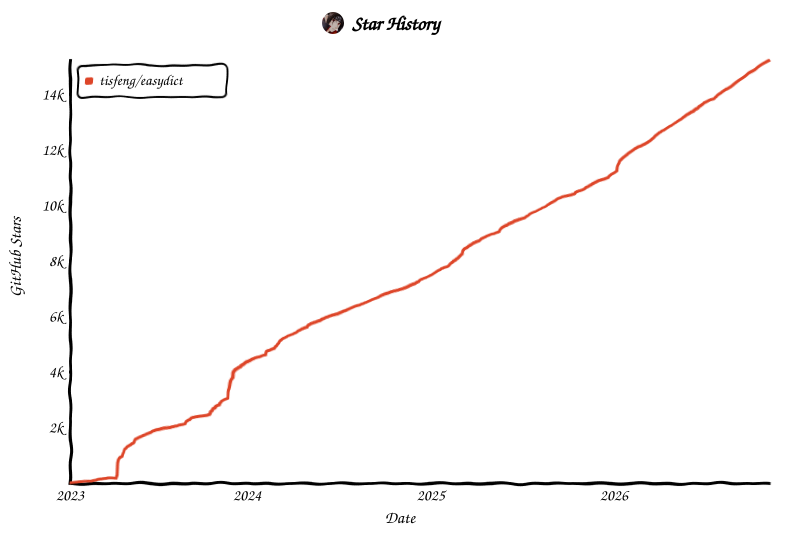

**原作者与官方仓库：[tisfeng / Easydict](https://github.com/tisfeng/Easydict)。**

# Easydict 理工科公式 Beta

这是由 [Box-Chen](https://github.com/Box-Chen) 提供的非官方 Beta，仅在 [上游 PR #1391](https://github.com/tisfeng/Easydict/pull/1391) 等待审查及发布期间，供有需要的用户提前体验。等原作者发布包含这些新增功能的正式版本后，我们会关闭 Beta 下载并删除本临时仓库。日常使用可前往 [Easydict 官方发布页](https://github.com/tisfeng/Easydict/releases)。

**[下载 macOS Beta](https://github.com/Box-Chen/Easydict-Formula-Beta/releases/tag/v2.27.0-formula-beta.2)** · [对应源码](https://github.com/Box-Chen/Easydict-Formula-Beta/tree/v2.27.0-formula-beta.2) · [GPL-3.0 许可证](./LICENSE)

应用最低目标为 macOS 13。公式模式还需要适用于该系统的本机 Codex CLI。下载 Release 里的 ZIP，解压后打开 **Easydict Formula Beta.app**。它使用独立的应用标识，可以与官方 Easydict 并存。此包采用临时签名，未经 Apple 公证，macOS 可能拦截首次打开。也可以从同一版本的源码自行编译。[Apple 的打开提示说明](https://support.apple.com/102445)

首次使用公式模式时，先安装本机 Codex CLI 并用自己的 ChatGPT 账户登录。公式模式会把框选的画面发送给 Codex 处理。在菜单栏或翻译窗口顶部打开「理工科公式模式」，用截图翻译快捷键（默认 `⌥S`）框选公式，按提示为 Beta 单独授予屏幕录制权限。Beta 2 会先流式显示译文，公式写完整后排版，最后补上可复制的原文。原文和译文都支持 LaTeX。点击 Codex 卡片上的模型名称可选视觉模型与思考强度。公式模式下，GPT-6 Luna 选「默认」时使用 Low。关闭公式模式后可使用普通 OCR 翻译。查询历史、最近截图和 OCR 原文日志的自动保存默认关闭，可在「设置 → 隐私」调整。

### 从对应源码构建

用 Xcode（本次使用 27.2）打开 `Easydict.xcworkspace`，选择 `Easydict` scheme 和 Release 配置。仓库已包含 CocoaPods 依赖，首次构建需联网解析 Swift Package。也可以运行：

```sh
EASYDICT_RELEASE_PACKAGING=YES xcodebuild build \
  -workspace Easydict.xcworkspace -scheme Easydict -configuration Release \
  -destination 'generic/platform=macOS' -derivedDataPath .tmp/formula-beta-build \
  ARCHS="arm64 x86_64" ONLY_ACTIVE_ARCH=NO CODE_SIGN_IDENTITY=- \
  CODE_SIGN_STYLE=Manual PROVISIONING_PROFILE_SPECIFIER= DEVELOPMENT_TEAM= \
  CODE_SIGN_ENTITLEMENTS=
```

<details>
<summary>上游 Easydict 项目介绍 / Upstream Easydict README</summary>

<p align="center">
  
  <h1 align="center">Easydict</h1>
  <h4 align="center"> Easy to look up words or translate text</h4>
<p align="center"> 
<a href="https://github.com/tisfeng/easydict/blob/main/LICENSE">
</a>
<a href="https://github.com/tisfeng/Easydict/releases">
</a>
<a href="https://img.shields.io/badge/-macOS-black?&logo=apple&logoColor=white">
</a>  
</p>

<div align="center">
<a href="./README_ZH.md">中文</a> &nbsp;&nbsp;|&nbsp;&nbsp; <a href="./README.md">English</a>
</div>

## Easydict

`Easydict` 是一个简洁易用的词典翻译 macOS App，能够轻松优雅地查找单词或翻译文本。

Easydict 开箱即用，能自动识别输入文本语言，支持输入翻译、划词翻译和 OCR 截图翻译，可同时查询多个翻译服务结果。

**支持的服务：** 覆盖 Apple Dictionary、MDict、Apple 翻译、OpenAI、Gemini、Claude、
DeepSeek、Ollama、Claude Code、Codex CLI、DeepL、Google、Bing 等 20+ 词典、翻译、AI、
本地模型和 CLI 服务。完整清单和配置条件见[服务总览](./docs/user-docs/zh/SERVICES.md)。


<table>
    <td> 
    <td> 
</table>


## 功能特性

- 🚀 开箱即用，自动识别输入语言
- 🖱️ 鼠标自动划词和快捷键划词
- 📸 OCR 截图翻译，静默截图 OCR
- 🔊 多种 TTS 语音服务
- 📚 支持 🍎 [苹果系统词典](./docs/user-docs/zh/How-to-use-macOS-system-dictionary-in-Easydict.md) 和 [系统翻译](./docs/user-docs/zh/How-to-use-macOS-system-translation-in-Easydict.md)
- 🌐 支持 20+ 词典、翻译、AI、本地模型和 CLI 服务
- 🗣️ 支持 52 种可选翻译语言

**如果觉得这个应用还不错，给个 [Star](https://github.com/tisfeng/Easydict) ⭐️ 支持一下吧 (^-^)**

## 贡献

欢迎通过 issue 和 Pull Request 参与 Easydict 的改进。开发流程和 PR 要求请参阅
[贡献指南](./CONTRIBUTING.md)。

### AI 辅助编程

欢迎使用 `Codex`、`Claude` 等编程 Agent 参与 Easydict 的开发。建议选择当前最新、适合
复杂编程任务的 GPT 或 Claude 模型，并仔细 review 和测试最终改动。Agent 开发流程和
review 要求请参阅[贡献指南](./CONTRIBUTING.md)。

## Issue/PR 处理说明

开发者近期比较忙，通常只有周末才有时间集中处理 issue。我们会优先处理 PR（尤其是修复类 PR）。同时邮件和通知积压较多，部分反馈可能无法第一时间看到或回复，敬请理解。

## 安装

### Homebrew 安装（推荐）

```bash
brew install --cask easydict
```

### 手动下载安装

[下载](https://github.com/tisfeng/Easydict/releases) 最新版本的 Easydict。

> [!NOTE]
> 最新版本支持 macOS 13.0+，如果系统版本为 macOS 11.0+，请使用 [2.7.2](https://github.com/tisfeng/Easydict/releases/tag/2.7.2)

---

## 使用方式

| 使用方式 | 说明 | 预览 |
| --- | --- | --- |
| 输入翻译 | 按输入快捷键（默认 ⌥ + A），输入文本后回车翻译 |  |
| 鼠标划词翻译 | 选中文本后出现查询图标，鼠标悬停即可翻译 |  |
| 快捷键划词翻译 | 选中文本后按快捷键（默认 ⌥ + D）翻译 |  |
| 截图翻译 | 按截图快捷键（默认 ⌥ + S）截取区域翻译 |  |
| 静默截图 OCR   | 按下静默截图快捷键（默认 `⌥ + ⇧ + S`），截取需要 OCR 的区域，截图 OCR 结果将自动保存到剪贴板 |                     |

---

## 文档

- 📖 [完整使用指南](./docs/user-docs/zh/GUIDE.md) - 详细功能说明和配置方法
- 🌐 [服务总览](./docs/user-docs/zh/SERVICES.md) - 完整服务清单和配置条件
- 🔧 [开发者构建指南](./docs/user-docs/zh/GUIDE.md#开发者构建) - 从源码编译运行
- 🍎 [如何使用 macOS 系统词典](./docs/user-docs/zh/How-to-use-macOS-system-dictionary-in-Easydict.md)
- 📚 [如何使用 MDict](./docs/user-docs/zh/How-to-use-MDict-in-Easydict.md)
- 🍎 [如何使用 macOS 系统翻译](./docs/user-docs/zh/How-to-use-macOS-system-translation-in-Easydict.md)
- 🌍 [如何帮助翻译 Easydict](./docs/user-docs/zh/How-to-translate-Easydict.md)

---

## 致谢

- 这个项目的灵感来自 [saladict](https://github.com/crimx/ext-saladict) 和 [Bob](https://github.com/ripperhe/Bob)，且初始版本是以 [Bob (GPL-3.0)](https://github.com/1xiaocainiao/Bob) 为基础开发。Easydict 在原项目上进行了许多改进和优化，很多功能和 UI 都参考了 Bob。
- 截图功能是基于 [isee15](https://github.com/isee15) 的 [Capture-Screen-For-Multi-Screens-On-Mac](https://github.com/isee15/Capture-Screen-For-Multi-Screens-On-Mac)，并在此基础上进行了优化。
- 鼠标划词功能参考了 [PopClip](https://pilotmoon.com/popclip/)。

## 声明

Easydict 为 [GPL-3.0](https://github.com/tisfeng/Easydict/blob/main/LICENSE) 开源协议，仅供学习交流，任何人都可以免费获取该产品和源代码。如果你认为您的合法权益受到侵犯，请立即联系[作者](https://github.com/tisfeng)。你可以自由使用源代码，但必须附上相应的许可证和版权声明。

## 赞助支持

Easydict 作为一个免费开源的非盈利项目，目前主要是作者个人在开发和维护，如果你喜欢这个项目，觉得它对你有帮助，可以考虑赞助支持一下这个项目，用爱发电，让它能够走得更远。

感谢 [@CanglongCl](https://github.com/CanglongCl) 提供的苹果开发者账号，解决了应用 [签名问题](https://github.com/tisfeng/Easydict/issues/2)，让更多人能够方便地使用 Easydict。

<a href="https://afdian.com/a/tisfeng"></a>

<div>
  
</div>

感谢所有支持者的赞助，详情请查看 [赞助列表](./docs/user-docs/zh/SPONSOR_LIST.md)。

---

## Star History

<a href="https://tisfeng.github.io/Easydict/star-history/#tisfeng/easydict&Date">
  <picture>
    <source media="(prefers-color-scheme: dark)" srcset="./docs/assets/star-history/star-history-dark.svg" />
    <source media="(prefers-color-scheme: light)" srcset="./docs/assets/star-history/star-history-light.svg" />
    
  </picture>
</a>

</details>
